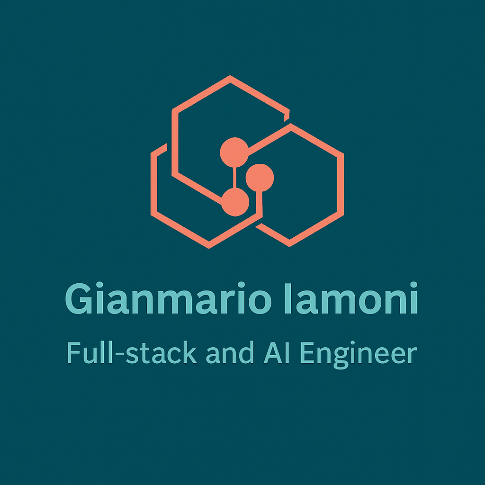

 

  

 

Crafting scalable, intelligent, end-to-end digital solutions.

---

# 🧩 About Me

I'm an **AI Engineer and Full-Stack Developer** focused on designing and building reliable, production-oriented AI systems and modern web applications.

My work combines Python-based AI engineering with full-stack development using TypeScript, React, Next.js, and modern database architectures.

I focus on turning LLM capabilities into structured application workflows, with particular attention to:

- **AI Engineering:** LLM integration, RAG pipelines, semantic retrieval, and multi-agent orchestration.
- **System Architecture:** LangGraph workflows, modular design, state management, and separation of concerns.
- **AI Reliability:** Structured outputs, deterministic evaluation, validation, error handling, and automated testing.
- **Production Readiness:** Observability, token budget governance, cost control, and maintainable deployment architectures.
- **Full-Stack Development:** Scalable APIs, multi-tenant SaaS applications, authentication, and database security.

With a background spanning software engineering, telecommunications, and enterprise technology environments, I bring a systems-oriented mindset to the design of digital products.

I collaborate remotely with Italian and international teams.

🌐 **Portfolio:** [gianmario-portfolio.onrender.com](https://gianmario-portfolio.onrender.com/)

---

# 🧱 Tech Stack

### Core Engineering

### AI Engineering & LLM Systems

### Databases & Retrieval

### Quality, Deployment & Tooling

---

# 🔥 Selected Projects

A selection of AI engineering and full-stack projects demonstrating my approach to architecture, intelligent workflows, and reliable software systems.

### 1. AI Interview Simulator

An AI-powered platform for practicing technical and behavioral interviews, with structured assessment and actionable feedback.

- Adaptive interview workflows tailored to the candidate's role, seniority, and difficulty level.
- Competency-based evaluation with structured scoring, strengths, improvement areas, and model answers.
- AI-assisted interview planning, follow-up questions, and difficulty adaptation.
- Structured reporting and feedback to support interview preparation.

**Stack:** Python, LLM APIs, AI workflow orchestration, automated testing.

🔗 [View repository](https://github.com/gianmarioiamoni/ai-interview-simulator) · [Portfolio](https://gianmario-portfolio.onrender.com/#work)

### 2. Enterprise AI Decision Engine

A structured decision-support system that combines knowledge retrieval, historical context, multi-stage analysis, and confidence modeling.

- Multi-stage LangGraph orchestration.
- RAG with separation of authoritative knowledge and historical precedents.
- Independent analysis and planning stages.
- Traceable decisions and structured reporting.

**Stack:** Python, LangGraph, LangChain, OpenAI, RAG.

🔗 [View repository](https://github.com/gianmarioiamoni/ai-decision-agent)

### 3. Tech Explanation Service

An AI-powered documentation assistant that generates structured technical explanations using Conditional RAG and real-time streaming.

- Dynamically selects documentation-based retrieval or general LLM knowledge.
- Streams generated answers in real time.
- Supports conversation history and document exports.
- Includes automated testing, usage tracking, and error handling.

**Stack:** Python, LangChain LCEL, OpenAI, ChromaDB, Gradio, SQLite, pytest.

🔗 [View repository](https://github.com/gianmarioiamoni/tech-explanation-service-langchain)

### 4. AI Knowledge Hub

A multi-tenant SaaS platform that transforms company documentation into an AI-powered knowledge assistant.

- Document ingestion, vectorization, and semantic retrieval.
- Context-aware question answering using RAG.
- Multi-tenant data architecture and database-level access control.
- Subscription-oriented SaaS architecture.

**Stack:** Next.js, TypeScript, React, Supabase, PostgreSQL, pgvector, LangChain, OpenAI, Stripe.

🔗 [View repository](https://github.com/gianmarioiamoni/ai-knowledge-hub)

---

# 🌟 Featured Repositories

<table>
  <tr>
    <td width="50%" valign="top">
      <h3>🎯 <a href="https://github.com/gianmarioiamoni/ai-interview-simulator">ai-interview-simulator</a></h3>
      

        <strong>AI-powered interview preparation.</strong> 
        An interactive platform for technical and behavioral interview practice, structured assessment, and actionable feedback.
      

      

        
        
        
      

      

        
        
      

    </td>
    <td width="50%" valign="top">
      <h3>🧠 <a href="https://github.com/gianmarioiamoni/ai-decision-agent">ai-decision-agent</a></h3>
      

        <strong>AI decision support and structured reasoning.</strong> 
        A stateful AI agent combining LangGraph orchestration, RAG, contextual analysis, and explainable decision support.
      

      

        
        
        
      

      

        
        
      

    </td>
  </tr>
  <tr>
    <td width="50%" valign="top">
      <h3>📚 <a href="https://github.com/gianmarioiamoni/tech-explanation-service-langchain">tech-explanation-service-langchain</a></h3>
      

        <strong>AI documentation assistant.</strong> 
        Conditional RAG, semantic retrieval, real-time streaming, structured explanations, and automated testing.
      

      

        
        
        
      

      

        
        
      

    </td>
    <td width="50%" valign="top">
      <h3>🏢 <a href="https://github.com/gianmarioiamoni/ai-knowledge-hub">ai-knowledge-hub</a></h3>
      

        <strong>Enterprise knowledge management SaaS.</strong> 
        Multi-tenant document intelligence, vector search, and context-aware answers using RAG.
      

      

        
        
        
      

      

        
        
      

    </td>
  </tr>
</table>

---

# 🧭 Engineering Focus (2026)

### AI Engineering

- Stateful agent architectures and workflow orchestration with LangGraph.
- Advanced RAG pipelines, hybrid retrieval, reranking, and contextual grounding.
- Structured outputs, deterministic evaluation, and AI quality assurance.
- Token budget governance, latency optimization, and cost-aware LLM integration.
- Observability, failure recovery, and reproducible AI workflows.

### Full-Stack & System Architecture

- Advanced Next.js and TypeScript application architecture.
- API design, modular services, and clean separation of concerns.
- PostgreSQL, pgvector, multi-tenant systems, and Row-Level Security.
- Authentication, authorization, data integrity, and application security.
- Automated testing, CI/CD, Docker, and deployment practices.

### Professional Development

- Building reliable AI-enabled products from architecture through deployment.
- Improving system evaluation, monitoring, and operational reliability.
- Applying disciplined engineering practices to AI-assisted development.

---

# 📊 GitHub Analytics

---

# ✍️ Engineering Mindset

> The goal is not simply to make LLMs generate answers. It is to engineer systems that make their outputs useful, testable, explainable, and operationally reliable.

I believe that successful AI engineering requires more than prompt engineering: it requires sound architecture, explicit workflows, measurable quality, and control over system behavior.

---

# 📫 Let's Connect

Interested in building **AI-powered applications, GenAI platforms, intelligent automation, or scalable SaaS products**?

Let's discuss how we can turn complex requirements into reliable software.

 

 

 

